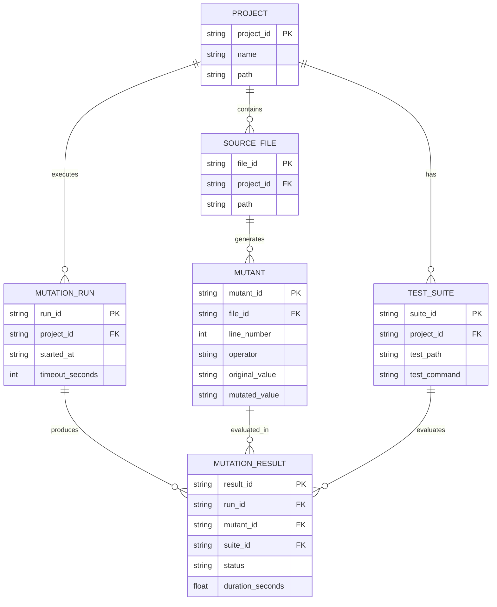
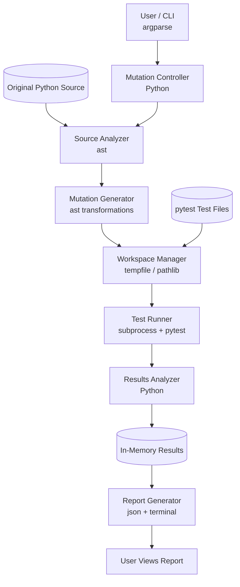

# Custom Mutation Testing Engine — Project Proposal

**Project Type:** Senior Computer Science Final Project  
**Estimated Development Time:** 20 hours  
**Primary Language:** Python  
**Focus:** Quality Assurance, ASTs, automated testing, software architecture

## 1. Project Purpose and Goals

### Summary

This project builds a **custom mutation testing engine** to evaluate whether a Python project's automated tests can detect small defects. Code coverage shows which code executes, but not necessarily whether tests would catch incorrect behavior. Mutation testing intentionally changes code and reruns tests to reveal weaknesses.

**Original:**

```python
def is_adult(age):
    return age >= 18
```

**Mutated:**

```python
def is_adult(age):
    return age > 18
```

A test checking `is_adult(18)` should detect the change (**killed mutant**). If all tests still pass, the mutant **survives**, suggesting a possible missing boundary test. Some surviving mutants may be equivalent to the original and do not necessarily indicate a defect.

### Goals

1. Create a Python command-line interface to select source code and pytest tests.
2. Parse Python files with the built-in `ast` module.
3. Implement at least four single-change mutation operators (such as `>=` to `>`, `==` to `!=`, `+` to `-`, and `and` to `or`).
4. Run existing tests against each mutation without modifying the user's original files.
5. Classify outcomes as killed, survived, timeout, or error.
6. Calculate a clearly defined mutation score and produce terminal and JSON reports.
7. Apply modular architecture, explicit error handling, and testability principles.

### Expected User Experience

```bash
python mutator.py --source calculator.py --tests tests/
```

Illustrative output:

```text
Mutation Testing Results
------------------------
Total Mutants:  12
Killed:          9
Survived:        3
Mutation Score: 75%

Surviving Mutations:
- calculator.py:12  >= changed to >
- calculator.py:25  + changed to -
- calculator.py:38  == changed to !=
```

The initial score is `killed / (killed + survived) * 100`; timeouts and execution errors are tracked separately and excluded from this denominator.

## 2. Initial Entity Relationship Diagram (ERD)

No database is needed for the MVP. This is a **logical ERD** for in-memory Python objects and exported JSON, not a physical relational schema. IDs are report identifiers rather than actual database keys.



| Entity | Description |
|---|---|
| Project | Local Python project under analysis. |
| Source File | Python source file containing mutation candidates. |
| Test Suite | Existing pytest tests and their invocation. |
| Mutant | A single, identified source-code change. |
| Mutation Run | One invocation of the engine with its configuration. |
| Mutation Result | Outcome of running tests against one mutant. |

**Reading:** original Python files, pytest tests, CLI options, and subprocess results.  
**Writing:** temporary mutated working copies, in-memory results, terminal output, and a JSON report. No permanent modifications to original source files.

## 3. Rough System Design



### Responsibilities

| Component | Technology | Responsibility |
|---|---|---|
| CLI | `argparse` | Validate options and start a run. |
| Mutation Controller | Python | Coordinate baseline tests and per-mutant workflow. |
| Source Analyzer | `ast` | Parse source and identify mutation locations. |
| Mutation Generator | `ast` | Produce one mutation at a time; never run tests. |
| Workspace Manager | `tempfile`, `pathlib` | Copy required project files and clean up temporary workspaces. |
| Test Runner | `subprocess`, `pytest` | Run baseline and mutant tests with timeouts. |
| Results Analyzer | Python | Classify outcomes and calculate scores. |
| Report Generator | `json` | Write structured results and terminal summaries. |

### Execution Sequence

1. Read CLI arguments and validate the trusted local project path.
2. Run the original test suite; stop or report an invalid baseline if it already fails.
3. Parse the selected source file into an AST.
4. Enumerate supported single-change mutations.
5. For each mutant, create a fresh temporary working copy and apply only that mutation.
6. Run pytest with a timeout and collect exit status and output.
7. Classify results and clean up the temporary workspace.
8. Calculate the score and export JSON and terminal reports.

**Safety and architecture:** Temporary directories protect original files from direct edits but do not sandbox Python execution. For the MVP, run only trusted local projects. Separate AST transformations, filesystem operations, test execution, and reporting. No DAO is required because there is no database or persistent domain store.

## 4. Initial Daily Goals

Plan: **five development days at four hours per day**.

| Day | Hours | Goals | Deliverable |
|---|---:|---|---|
| **1** | 4 | Repository setup, architecture, data models, CLI, AST parsing | CLI reads a file and identifies mutation candidates. |
| **2** | 4 | Implement four mutation operators and one-mutant-at-a-time generation | Valid mutants produced without changing originals. |
| **3** | 4 | Temporary workspace creation, baseline verification, pytest subprocess execution | Mutants can be tested and outcomes captured. |
| **4** | 4 | Result classification, scoring, JSON and terminal reports | Working end-to-end engine. |
| **5** | 4 | Unit tests, error and timeout cases, README, demo preparation | Tested and documented final submission. |
| **Total** | **20** | | |

### MVP Acceptance Criteria

- A CLI runs against a small trusted Python project.
- At least four AST mutation operators work correctly.
- Exactly one mutation is applied per test run.
- Original files remain unchanged, including after failures.
- A passing baseline is checked before mutation runs.
- Killed, survived, timeout, and error outcomes are distinguished.
- JSON and terminal reports include counts and a documented mutation score.
- Unit tests cover mutation operators and result classification.

**Stretch goals, only if time remains:** HTML reporting, configurable operators, parallel execution, GitHub Actions integration, or suggestions for tests that kill surviving mutants.

## 5. Architecture Principles

The project follows eight guiding principles: **(1)** preserve clear boundaries; **(2)** design persistence carefully, including the DAO rule; **(3)** design for cohesion and loose coupling; **(4)** treat external input as unsafe; **(5)** protect data and access; **(6)** build testability in; **(7)** handle errors and concurrency explicitly; and **(8)** make code readable.

Because the MVP is file-based, it will not add an unnecessary database or DAO. Filesystem access is isolated in the workspace and reporting components. The design prioritizes correctness and maintainability without overengineering a 20-hour project.
